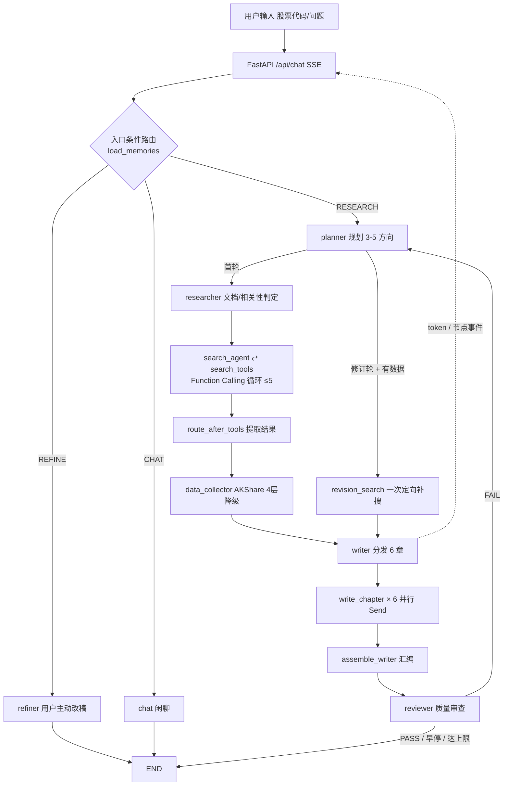

# 00 · IRIS 简历逐条应答与面试作战手册

> 生成：2026-11-13 ｜ 依据：对本仓代码的逐行核查（不是凭简历反推）  
> 用法：**面试前 5 分钟**看 §0 + §4 + §8；**前一晚**通读 §1 §2 §3；**被追问时**查 §5 §10。  
> 原则：**结论先行 → 证据 → 代价**。所有 ✅/⚠️/❌ 只标状态，不标情绪。

---

## §0 先改简历：8 处措辞与代码对不上

这是全篇最重要的一节。面试官只要一句「仓库能看下吗」或者往下追问一层，下面这些就会变成减分项。**改措辞的成本是 10 分钟，被当场拆穿的成本是整场面试。**

| # | 简历原句                            | 代码真相（证据）                                                                                                                                                                                                                                        | 状态 | 建议改成                                                           |
| - | ------------------------------- | ----------------------------------------------------------------------------------------------------------------------------------------------------------------------------------------------------------------------------------------------- | -- | -------------------------------------------------------------- |
| 1 | 「多智能体协作状态机」                     | 固定拓扑 + 条件边的 **Workflow**，不是自治 Multi-Agent；没有 agent 间自由通信。项目自己的 `docs/interview/05-面试深挖问答.md:11-12` 就承认了这点。`graph.py:238-256` 注册 15 个 `add_node`                                                                                                 | ⚠️ | 「基于 LangGraph 的 15 节点固定拓扑工作流，含 3 个 LLM 决策点」                    |
| 2 | 「自研 **ToolHub** 工具执行节点」         | 全仓搜不到 `ToolHub` 字面。实际叫 `search_tool_node`，在 `backend/app/graph/nodes/search_agent.py:82-113`，注释写「不依赖 langgraph.prebuilt」                                                                                                                        | ⚠️ | 「自研工具执行节点 `search_tool_node`，替代 `langgraph.prebuilt.ToolNode`」 |
| 3 | 「**仅重跑受影响章节与工具调用**」             | **未实现**。`writer.py:126-142` 每轮都用 `Send` 把 6 章**全部**重写，`critique_section` 广播给每一章。`docs/badcase-review.md:83-84` 白纸黑字「已定位，未实施」                                                                                                                    | ❌  | 「跳过重复研究管线，按审查意见做一次定向补搜后重写」                                     |
| 4 | 「修订轮耗时 **-27%**、Token **-71%**」 | `-27.1%` 是 **5 只样本的端到端延迟中位数**（598.2s→436.4s），不是「修订轮耗时」；`-71%` 是**单只 600196** 的 token（148.8K→43.0K）。中位 token 反而 **+11%**（27.6K→30.6K），000333 反向 **+362%**。数字只存在于 `docs/benchmark.md:95-103` 手写表格，无 A/B 脚本产出，项目自定证据级 C                            | ❌  | 「端到端延迟中位数 -27%（5 样本），个别样本 token 降幅达 71%」，并主动交代恶化样本；或干脆删数字      |
| 5 | 「**检索熔断**防死循环」                  | 没有熔断器。真实是四个独立机制：文档模式提前终止（`researcher.py:137-150`）、工具失败降级标记（`:18-44`）、FC 轮次上限 5（`search_agent.py:34` / `graph.py:167`）、主模型额度 TTL 熔断（`llm.py:61-92`，唯一真叫熔断的，但属于 LLM 不属检索）                                                                         | ⚠️ | 「迭代上限 + 相似度早停 + 工具失败降级 + 搜索轮次上限」                               |
| 6 | 「来源标注率 **100%**」                | 设计上确实硬：`prompts.py:111/136/162` 由代码逐行拼 `\| 指标 \| 数值 \| [来源: xxx] \|`，不经 LLM。但 benchmark 里的 100% 是 `source_rate = min(100, round(source_tags / SOURCE_TAG_THRESHOLD * 100))`（`backend/eval/benchmark_run.py:114-116`）——标签计数/阈值后**封顶**，不是逐数值覆盖率核验 | ⚠️ | 「结构化数值表格由代码直出、逐行带来源列，LLM 不参与数值生成」；被问 100% 时说明是设计约束不是实测覆盖率      |
| 7 | 「迭代上限（MAX_REVISIONS=3）」         | `config.py:12` 和 `.env.example` 里的 `MAX_REVISIONS=3` **从未被任何代码 import**（死配置）。真正生效的是 `graph.py:30` 硬编码 `MAX_ITERATIONS = 5`                                                                                                                      | ⚠️ | 「图内硬性回炉上限，当前 5 次」；别报 3，别报「.env 可调」                             |
| 8 | 技术栈「Vue 3」                      | ✅ 属实但有两套：`frontend/`（Vue 3 + Pinia + markdown-it，`package.json:23`）、`frontend-next/`（React/TSX + assistant-ui）。生产 Nginx 托管 `frontend/dist`（`DEPLOY.md:124`），即 Vue 3 那套                                                                          | ✅  | 保留，但要准备好回答「为什么两套前端」                                            |

**✅ 完全属实、可放心讲**：gte-rerank 两阶段精排 + 异常降级、4 层行情降级链、表格数值不经 LLM、MCP 5 个只读工具的协议封装、SSE 生产者消费者 + 15s 心跳 + 空队列降级同步、公网部署、历史工具消息重放修重复搜索、搜索词 SSE 透传前端时间线。

> ⚠️ 另一条第 9 项风险（不在表里，因为它是「未验证」不是「不符」）：简历「**任意 MCP 客户端即插即用**」——5 个工具确实封装好了，但本机没装 `mcp` 包、也没有 `.venv`，Server 从未启动验证过。详见模块 4 最后一问与 §8 命令 ③。**面试前跑通，或把这句改成「封装为 MCP Server，支持 stdio 接入」。**

> 💡 顺手修掉一处旧材料：`docs/interview/05-面试深挖问答.md:41-42` 的 Q13 说「reranker 默认关，因为 +400MB 内存」——那是**本地 CrossEncoder 时代**的口径。现在 `config.py:19` 默认 `ENABLE_RERANKER=true`，走 DashScope `gte-rerank-v2` API（`reranker.py`、`config.py:20-21`），不再吃本机内存。面试别再讲旧答案。

### 为什么我建议主动改而不是硬扛

金融/AI 岗面试官现在普遍会问「能看下仓库吗」「这个数字怎么测的」。IRIS 是**已公网部署 + 代码可查**的项目，上面 8 条的证据都在同一个仓库里。硬扛的收益是简历好看一点，风险是被判定「项目注水」，而这一条通常直接终局。**把措辞收紧到代码能支撑的范围，项目本身反而更硬**——光「自研工具节点 + 历史消息重放修重复搜索 + 数值直取防幻觉」这三件事就够撑起一场技术面。

---

## §1 三版自我介绍（可直接背）

### 30 秒版（开场 / 群面 / 电话初筛）

> IRIS 是一个面向 A 股投研的报告生成平台。用户输入股票代码，系统用 LangGraph 编排一条 15 节点的工作流：先规划检索方向，再由 Function Calling 决定搜什么、搜几轮，同时用 AKShare 系工具拉行情财务数据，然后分 6 章写中文研报，最后有个 reviewer 节点审查，不合格带着意见回炉重写。我最主要解决的是两类问题：一是**金融场景不能编数字**，所以数值表格由代码直接从数据源生成、逐行带来源，LLM 只写观点；二是**长链路的延迟和成本**，所以做了修订快速通道，复用已有数据、只做一次定向补搜。后端 FastAPI + SSE 流式交付，前后端已公网部署，另外把 5 个数据工具封装成了 MCP Server，别的 Agent 也能直接调。

### 2 分钟版（技术一面主用）

在 30 秒版基础上加这四段，按「约束 → 选择 → 代价」讲：

1. **为什么用图而不是 while 循环**：有三条结构性分支——新研究 / 追问改稿 / 闲聊的入口路由、审查 FAIL 的回炉边、Function Calling 的多轮循环。用 `StateGraph` 能拿到显式拓扑、checkpoint 持久化（`AsyncSqliteSaver`）、`add_messages` reducer 自动累加消息历史。代价是拓扑在模块导入期构建，**加节点要重启服务**，以及框架版本耦合——这也是我不用 `prebuilt.ToolNode`、自己写执行节点的原因。
2. **可信性怎么保证**：数值和观点分离。检索侧是 ChromaDB 粗召回 20 条 + DashScope gte-rerank 精排到 5 条，rerank 3 秒超时或异常就 fail-open 降级成纯向量序；行情侧是四层降级（同花顺官方 API → 东财 → 雪球/新浪 → 内置模拟数据），降级到底会打 `degraded=true` 并标注「内置模拟数据」，下游 writer 看到就写「⚠️ 数据不足，暂不评价」而不是照抄。
3. **流式怎么做**：FastAPI 里每个请求建两个 `asyncio.Queue`（token 流 + 节点事件流），LLM 的同步 `stream()` 跑在生产者线程，通过 `run_coroutine_threadsafe` 灌进队列，async 消费者推 SSE；15 秒没有数据发一个 `: heartbeat`。队列不存在时自动降级成同步 `llm_invoke()`，非流式接口复用同一套节点代码。踩过一个坑：LangGraph 的 `Send` 并行分支不保证继承请求任务的 ContextVar，导致分章进度和 token 全丢，后来改成按 `thread_id` 的显式队列注册表。
4. **诚实交代边界**：这是固定拓扑 Workflow，不是自治 Multi-Agent；目前端到端中位延迟还有约 7 分钟，主因是修订仍是 6 章全量重写；样本 benchmark 只实测了 5 只股票。这三个我都还在做。

### 5 分钟版（技术二面 / 项目深挖）

按 §3 四大模块逐个展开，每个模块讲「问题 → 方案 → 代码在哪 → 代价」，最后用 §7 主动交底收尾。**不要背成流水账**，边讲边在白板上画 §6 的图 1。

---

## §2 一页架构（面试时照着画）



**画的时候口头补 5 个点**（这 5 个是区分度）：

1. `router` 不是节点，是挂在 `load_memories` 上的条件边（`graph.py:257-266`），它读 `preset_route` 复用 SSE 端点预跑的结果，避免同一请求做两次 LLM 意图分类。
2. 审查 FAIL **回到 planner，不是 refiner**；`refiner → END` 是用户主动改稿，两条路完全独立。这个最容易被问倒。
3. `writer → write_chapter` 没有静态边，是 `Command(goto=[Send(...) for spec in CHAPTER_SPECS])` 动态 map-reduce 分发 6 章。
4. 修订快速通道的判定条件是 `revision_number >= 1 and financial_data 非空`（`graph.py:155-161`）；没有数据时退回完整研究管线，不做无米之炊。
5. `should_continue` 里共 4 道终止闸：降级错误继续但打标、early_stop、迭代上限、review_status。

### 一次请求的时序（口述用）

```
① POST /api/chat → 预跑意图分类（发 intent 事件，结果写 preset_route）
② 建 token_q / node_event_q，register_queues(thread_id)
③ graph.astream() 在后台任务跑；主协程循环消费两个队列
④ 节点 traced_* 包装器发 start/done 事件；search_tools 发 search_query
⑤ writer 分章流式 token 逐个入队 → SSE data: 帧
⑥ 15s 无数据 → ": heartbeat\n\n"
⑦ 结束发 final，unregister_queues，写 checkpoint + conversation_summary
```

---

## §3 四大模块逐条深挖

统一答法模板：**「约束是什么 → 我选了什么 → 代价/边界是什么 → 代码在哪」**。面试官要的不是名词，是你为什么这么选。

---

### 模块 1 · 多智能体编排（简历第 1 条）

> **简历原句**：基于 LangGraph 搭建多智能体协作状态机，条件路由实现「规划→检索→工具调用→撰写→审查→修订」闭环，审查不合格自动回退重写；通过迭代上限、相似度早停、检索熔断防死循环；针对修订轮次重跑全链路的问题设计增量改稿快速通道，仅重跑受影响章节与工具调用，修订轮耗时 -27%、Token -71%。

#### ✅ 代码真相

| 说法         | 实际                                                                                                                                                                                                                  | 证据                                                                |
| ---------- | ------------------------------------------------------------------------------------------------------------------------------------------------------------------------------------------------------------------- | ----------------------------------------------------------------- |
| 状态机        | `StateGraph(AgentState)`，15 个 `add_node`                                                                                                                                                                            | `graph.py:238-256`                                                |
| 入口条件路由     | `set_entry_point("load_memories")` + `add_conditional_edges` 挂在首节点上，**不是** `set_conditional_entry_point`（简历没写这个 API，但旧文档写了，别照抄）                                                                                     | `graph.py:257-266`                                                |
| 审查回炉       | `reviewer --FAIL--> planner`，不是 `refiner`；回炉后 writer 把 `critique` 注入提示词要求修正                                                                                                                                         | `graph.py:229-231`、`writer.py:115-122`                            |
| 迭代上限       | 硬编码 `MAX_ITERATIONS = 5`；`config.py` 的 `MAX_REVISIONS=3` 无人引用                                                                                                                                                       | `graph.py:30, 219-223`                                            |
| 相似度早停      | **TF-IDF 词频余弦**（sklearn），当前报告 vs `report_history[-1]`，`> 0.95` 强制 PASS                                                                                                                                              | `reviewer.py:51-69, 98-127`                                       |
| 防循环其余      | 文档模式 `should_stop → END`、工具失败 `degraded` 标记、FC 轮次上限 5、主模型额度 TTL 300s 熔断                                                                                                                                             | `researcher.py:18-44,137-150`、`search_agent.py:34`、`llm.py:61-92` |
| 快速通道       | `revision_number>=1 且 financial_data 非空` → `planner → revision_search → writer`，跳过 `researcher / search_agent / search_tools / route_after_tools / data_collector`；`revision_search` 只做**一次** Tavily 定向补搜，fail-open | `graph.py:155-161`、`revision_search.py:18-37`                     |
| 仅重跑受影响章节   | ❌ **没有**。`writer` 用 `Send` 对 `CHAPTER_SPECS` 全 6 章并行重写，`critique_section` 广播给每章                                                                                                                                     | `writer.py:126-142, 169`                                          |
| checkpoint | LangGraph 内置 `MemorySaver`（测试）/ `AsyncSqliteSaver`（生产），`create_graph()` 只 compile 不重建拓扑                                                                                                                             | `checkpoint.py:1-17`、`graph.py:303-305`                           |

#### 🗣 怎么讲（60 秒口述稿）

> 这条链路我用 LangGraph 的 `StateGraph` 表达，因为它本质上有三条结构分支：入口三意图路由、审查 FAIL 的回炉边、Function Calling 的多轮循环。审查不通过时回到 planner，但不是傻乎乎把检索全重跑一遍——我在 planner 后面加了条件路由：只要 `revision_number >= 1` 且 state 里已经有 `financial_data`，就走快速通道，用审查意见拼一个定向 query 补搜一次，直接进 writer；已有数据和搜索结果都在 checkpoint 的 state 里，复用就行。防死循环一共四道闸：回炉次数上限 5、连续两版报告 TF-IDF 余弦超过 0.95 判定改不动了就早停、Function Calling 搜索轮次上限、工具失败打降级标记而不是抛异常。**这里我要说清楚一个没做完的地方**：目前修订仍然是 6 章全量重写，我只砍掉了重复的研究管线，没做到按 critique 定点改章节——这是我自己列的下一个优化项。

#### ⚠️ 必被追问

**Q：为什么用 LangGraph，不自己写 while 循环？**

> 三个硬需求：审查回炉是有环的图、入口有三分支、分章写作是并行 map-reduce。自己写要手搓状态持久化、消息累加、断点恢复。LangGraph 直接给 `checkpointer`（生产用 `AsyncSqliteSaver`）和 `add_messages` reducer（`state.py:12`）。代价：拓扑在模块导入期一次性构建，加节点必须重启；框架版本耦合——所以我不用 `prebuilt`，自己写工具执行节点。

**Q：State 里为什么把 `revision_number` 放进去，不能用局部变量？**

> 因为它是「回炉深度」，被四个地方消费：`should_continue` 的上限判断、`route_after_planner` 的快速通道判定、SSE 事件/trace 的可观测字段、checkpoint 断点恢复。放循环变量里等于既不可观测也不可恢复。`report_history` 同理，必须**通过节点返回值**持久化，就地改 `state` 字典 LangGraph 不会保存——这个我踩过，代码里 `reviewer.py:127` 有注释。

**Q：相似度怎么算的？为什么不用 embedding？**（⚠ 灵魂题，别答错）

> 是 sklearn 的 `TfidfVectorizer` + `cosine_similarity`，**词频向量余弦，不是 embedding 语义相似度**，比较当前报告和上一版。选它是因为早停只是个「改不动了」的兜底信号，要的是零外部调用、毫秒级、无网络依赖；用 embedding 每次审查多一次 API 调用和延迟，不划算。阈值 0.95 是硬编码在 `reviewer.py:107`。**代价我承认**：词频相似对「换了个说法但内容没变」不敏感，而且 sklearn 缺依赖或异常时函数返回 0.0，早停会静默失效——真要上生产应该改成可观测的失败计数 + 配置化阈值。

**Q：既然有快速通道，为什么延迟还是 7 分钟？**

> 因为瓶颈已经转移了。`docs/benchmark.md:107` 记的 badcase：000333 连续 5 轮不满意，每轮仍触发全文重写，端到端反而 +362%。我砍掉了重复搜索，没砍掉重复写作。下一个杠杆是把 `critique` 解析成章节定位，只 `Send` 受影响的 1-2 章，其余章节复用 `report_sections` 里的缓存。**这个还没实现**，我不会说做完了。

**Q：这是 Multi-Agent 吗？**

> 诚实说，不是自治 Multi-Agent，是固定拓扑 + 条件边的 Workflow。没有 agent 之间自由通信和动态任务分配，只有三个 LLM 决策点：入口意图分类、search_agent 的工具选择循环、reviewer 的通过/回炉。把它叫「多智能体」是简历措辞宽了；我认为敢给自己的架构准确定性比硬套概念更重要。

**Q：如果 reviewer 自己判断错了、一直 FAIL 怎么办？**

> 四道闸兜底：次数到 5 强制 END；两版相似度 > 0.95 早停；`degraded` 错误继续但打标；`should_continue` 汇总 `early_stop / should_continue=False`。最坏情况是拿第 5 版交付，不会无限循环。**残余风险**：早停会把「改不动」误判成「合格」，输出 PASS 但报告质量仍不达标——所以 critique 里会写明「相似度 x.xxx，强制结束」，前端和用户能看到，不是静默通过。

---

### 模块 2 · 工具调用（简历第 2 条）

> **简历原句**：针对模型重复搜索、工具消息流不可控的问题，自研 ToolHub 工具执行节点替代 LangGraph 内置 ToolNode；通过历史工具消息重放修复重复搜索类缺陷，搜索词经 SSE 实时透传前端时间线，调用过程可观测。

#### ✅ 代码真相

| 说法        | 实际                                                                                                                                                  | 证据                                                                      |
| --------- | --------------------------------------------------------------------------------------------------------------------------------------------------- | ----------------------------------------------------------------------- |
| 「ToolHub」 | ⚠️ 无此命名。实际是 `search_tool_node`，注释明写「不依赖 `langgraph.prebuilt`」                                                                                       | `search_agent.py:82-83`                                                 |
| 工具绑定      | `TOOLS = [search_web]`（**图内 FC 只有 1 个工具**），`llm.bind_tools(TOOLS)`                                                                                  | `search_agent.py:17, 70`                                                |
| 历史消息重放    | ✅ **这条最扎实**。`all_messages = [System, Human] + messages`，注释原文：「重放此前的 assistant tool_calls + ToolMessage 搜索结果。缺了这段 LLM 每轮都看不到已搜内容，只能盲目重复搜索（原实现的缺陷）」   | `search_agent.py:58-66`                                                 |
| 工具执行      | 遍历 `last_msg.tool_calls`，`search_web.invoke(tool_args)`，回 `ToolMessage(content, tool_call_id, name)`；必须带 `tool_call_id`，否则 OpenAI/Anthropic 消息校验会报错 | `search_agent.py:92-113`                                                |
| 搜索词透传     | `emit_node_event("search_tools", "done", data={"search_query": ...})` → 前端 `graphStore.ts:98-99` 写入 `searchLog` → `ResearchTimeline.tsx` 渲染         | `search_agent.py:103-105`、`frontend-next/src/store/graphStore.ts:98-99` |
| 结果提取      | `route_after_tools` 扫 `msg.type == "tool"`，拼成 `search_results`                                                                                      | `search_agent.py:115-130`                                               |
| 循环上限      | 节点侧 `iteration > 5`、图侧 `search_iteration >= 5` 双保险                                                                                                  | `search_agent.py:34-37`、`graph.py:164-169`                              |


#### 🗣 怎么讲（45 秒口述稿）

> Function Calling 循环是 `search_agent ⇄ search_tools`。我没用 `langgraph.prebuilt.ToolNode`，一是框架版本兼容，二是我需要精确控制消息流和往外发事件。这里有个真实 bug：第一版每轮只给 LLM 发 System + 当前任务，LLM 看不到上一轮搜了什么、搜到了什么，于是反复用相似关键词重搜，5 轮额度全耗在同一批结果上。修复是把 state 里的 `messages` 全量重放进 `all_messages`——`add_messages` reducer 已经把 AI 的 `tool_calls` 和 `ToolMessage` 结果都累加好了，LLM 一看「哦这个方向搜过了、结果够用」，就会自己停。同时我在工具执行节点里把 LLM 决定的 `query` 通过 `search_query` 事件推到 SSE，前端时间线实时显示这次搜了什么词，调用过程从黑盒变成可观测。

#### ⚠️ 必被追问

**Q：为什么不用 `prebuilt.ToolNode`？它自带 `handle_tool_errors`。**

> 三个原因：① 当时 LangGraph 版本里 prebuilt 的接口在变，自定义节点只依赖 `langchain_core.messages`，稳；② 我要在执行的同一位置 `emit_node_event` 把搜索词推给前端，prebuilt 塞不进这层副作用；③ 我要自己控制 `ToolMessage` 的构造和 `search_results` 的提取时机（第三个节点 `route_after_tools` 统一扫 tool 消息）。代价是错误处理得自己写——现在 `search_web` 内部保证永不抛异常、失败返回结构化 JSON，所以执行节点不需要 `handle_tool_errors` 那层兜底。

**Q：历史消息重放为什么能修重复搜索？根因到底是什么？**

> 根因是**信息缺失不是模型能力问题**。LLM 每轮看到的上下文里没有「已执行过的 tool_calls」和「对应结果」，它的世界模型里上一轮搜索等于没发生过，于是按 plan 重新发起第一方向的搜索。重放之后它同时看到「我调过什么」和「拿回了什么」，才能做「结果是否充分」的判断。`add_messages` reducer 负责累加，我负责在每轮组装时把这段历史接回去。另外还加了 5 轮硬上限，防止判断失误时无限循环。

**Q：既然只有 `search_web` 一个工具，怎么叫「工具消息流不可控」？**（⚠ 容易被将）

> 图内 Function Calling 循环绑定的确实只有 `search_web` 一个；「不可控」指的不是工具种类多，是**多轮循环里消息流不可控**——每轮 AIMessage 的 `tool_calls`、ToolMessage 的 `tool_call_id` 配对、结果何时提取、以及 LLM 何时该停。5 个数据工具是另一层：`data_collector` 和 MCP Server 那边，走的是 `@tool` 声明 + 直接调用，不进 FC 循环。**这两层别混着讲。**

**Q：`messages` 无限增长怎么办？**

> 目前单轮请求内最多 5 轮搜索，量可控；跨轮靠 `conversation_summary` 增量压缩（超 2000 字符触发，`memory.py`）+ 检索方向去重。**诚实说**：没有做基于 token 预算的硬裁剪，长会话仍可能撑大上下文，这是已知短板。

**Q：`tool_call_id` 不传会怎样？**

> 主流 provider 会做消息序列校验，缺少 `tool_call_id` 或和上一轮 `tool_calls` 对不上会直接报 message validation error，整条链断掉。所以自定义执行节点里 `ToolMessage(..., tool_call_id=tool_id)` 是必须项，不是装饰（`search_agent.py:110`）。

**Q：怎么证明修好了？**

> `backend/tests/test_search_agent.py` 覆盖 FC 决策与轮次上限，`backend/tests/integration/test_router_fallback.py` 覆盖路由与早停；行为层面我在 SSE 时间线上直接看 `searchLog` 里还有没有重复的相似 query——这是可观测性带来的额外收益，不用翻日志。

---

### 模块 3 · RAG 与数据可信（简历第 3 条）

> **简历原句**：针对金融场景 LLM 易编造数值的问题，研报语料经 ChromaDB 粗召回 + gte-rerank 精排（异常降级），行情数据接 4 层降级数据源保障可用性；表格数值直取数据源、不经 LLM 改写，数据与观点分离，来源标注率 100%。

**这条是四个模块里最扎实的，可以放开讲。**

#### ✅ 代码真相

| 说法        | 实际                                                                                      | 证据                                                               |
| --------- | --------------------------------------------------------------------------------------- | ---------------------------------------------------------------- |
| 两阶段检索     | `RerankRetriever`：Chroma 向量召回 `fetch_k=20` → gte-rerank 精排 → `top_k=5`                  | `engine.py:33-41, 45, 51`                                        |
| embedding | DashScope `text-embedding-v4`                                                           | `engine.py:65`                                                   |
| 精排模型      | `gte-rerank-v2` API，非本地 CrossEncoder；超时 `RERANK_TIMEOUT_S=3`                            | `config.py:20-21`、`reranker.py:2-7`                              |
| 异常降级      | ✅ fail-open：rerank 抛 `RerankError`/超时 → 返回 `candidates[:top_k]` 纯向量序，检索不阻塞              | `engine.py:49-54`、`report_ingest.py:282-285`、`reranker.py:76-77` |
| 切片        | `CHUNK_SIZE=500` / `CHUNK_OVERLAP=50`，PyMuPDF 抽 PDF 全文                                  | `config.py:15-16`、`report_ingest.py`                             |
| 4 层降级     | L0 同花顺官方 API → L1 东财 → L2 雪球/新浪 → L3 内置模拟数据；**每个工具各自一条链**（info / indicators / quote）    | `akshare_tools.py:151, 173, 193, 217-227`                        |
| 降级诚实      | mock 兜底必打 `degraded=true` + `data_source="内置模拟数据（异常降级: ...）"`，下游 writer 写「⚠️ 数据不足，暂不评价」 | `akshare_tools.py:229-230`、`prompts.py:15, 52`                   |
| 数值不经 LLM  | ✅ markdown 表格由 Python 逐行拼 `\| 指标 \| 数值 \| [来源: xxx] \|`                                 | `prompts.py:111, 136, 162`                                       |
| 100% 口径   | ⚠️ 是**设计约束 + benchmark 封顶近似**，不是逐数值覆盖率核验                                                | `benchmark_run.py:114-116`                                       |

#### 🗣 怎么讲（60 秒口述稿）

> 金融场景最怕的不是文笔差，是编数值——模型写出一个看起来很像真的 PE，用户拿去做决策。我的做法是**把数值从生成链路里摘出去**：`financial_data` 是个结构化 dict，六章报告里的「指标｜数值｜来源」三列表格由 Python 直接拼字符串生成，LLM 只负责观点段落，它根本没有改写数值的机会。检索侧做两阶段：ChromaDB 用 DashScope `text-embedding-v4` 粗召回 20 条，再调 `gte-rerank-v2` 精排取 5 条；rerank 是锦上添花，3 秒超时或异常就 fail-open 退回纯向量序，绝不阻塞检索。行情侧是四层降级，同花顺官方 API → 东财 → 雪球/新浪 → 内置模拟数据，降级到底必须打 `degraded` 和来源标记，writer 看到就写「数据不足，暂不评价」，绝不把模拟数据当真实数据引用。

#### ⚠️ 必被追问

**Q：为什么用 DashScope gte-rerank 而不是本地 CrossEncoder？**（⚠ 旧文档答案是错的，别背）

> 早期方案是本地 CrossEncoder，在 2G 服务器上要多吃约 400MB 内存，只能默认关掉。后来换成 DashScope 的 `gte-rerank-v2` HTTP API，内存压力没了，`ENABLE_RERANKER` 现在默认 `true`（`config.py:19`），2G 机器也能放心开（`DEPLOY.md:18`）。代价是引入一次外部网络调用和按量计费，所以用 3 秒硬超时 + fail-open 降级把风险锁住。**如果面试官看过旧版文档说「reranker 默认关」，正好可以讲这次演进**，比背一个静态答案强。

**Q：为什么 ChromaDB 不用 Milvus / pgvector？**

> 约束是单机 2 核 2G、研报量千级 chunk（`MAX_KNOWLEDGE_BASE_CHUNKS=2000`）。ChromaDB 嵌入式零运维、本地检索百毫秒内，够用。代价是不支持分布式和亿级向量；真到那个规模，迁移成本主要在 embedding 重建，而检索接口已经隔离在 `rag/engine.py` 的 `get_retriever()`，换存储不动上层。**当前规模下选型是对的，规模假设变了会重评**——别说成「ChromaDB 更好」。

**Q：chunk 500 / overlap 50 怎么定的？为什么不更大？**

> 研报 PDF 里一个论点常带一张表，500 字符大致能保住一个完整语义段；overlap 50 防止边界切断公司名或指标名。没有做网格搜索调参，是按语料结构拍的，配合 rerank 精排补偿召回粒度。**诚实说这是经验值不是实测最优**，有 `backend/eval/rerank_eval.py` 跑 P@3 / MRR 的框架，但没做过 chunk 尺寸消融。

**Q：4 层降级实际都能走到吗？**（⚠ 会翻车的诚实题）

> 代码里四层都在，但**生产服务器上东财直连被封（Connection aborted）**，实际可达的主要是同花顺 L0，降级链在部署环境里接近单链（`AGENTS.md` 数据层说明）。所以我不把「4 层」讲成高可用成果，而是讲成「接口层做了多级兜底设计，但真实可用性取决于出口网络，这一点我们线上吃过亏」。另外 L3 是模拟数据，它保障的是**不崩 + 诚实标注**，不是数据正确。

**Q：mock 数据会不会混进研报被当真？**

> 会，如果不处理的话。所以三道锁：工具返回里带 `degraded` 和 `data_source` 标记；`generate_source_tags()` 会给备用源加「（备用数据源）」后缀（`prompts.py:183-189`）；writer 提示词强制要求对数据不足的维度写「⚠️ 数据不足，暂不评价」。`tests/test_fault_injection.py` 和 `test_fallback_to_mock` 断言降级标记不丢。

**Q：「来源标注率 100%」怎么测的？**（⚠ 必问，别硬撑）

> 要分清两件事：**设计上**，结构化表格每一行都由代码拼出 `[来源: xxx]`，LLM 不参与，所以表格数值的来源列是 100% 覆盖的硬约束；**benchmark 里那个 100%**，是 `source_rate = min(100, round(标签数 / SOURCE_TAG_THRESHOLD * 100))`，用正则数报告里出现多少次「来源:」再除以阈值封顶，是个近似指标，不等于逐个数值核验覆盖率。我会这么说：「表格数值的来源标注是代码保证的，但报告里观点段落引用的来源完整性目前只有标签计数的近似统计，没有做逐条溯源核验。」这比报一个 100% 稳。

**Q：为什么不干脆做结构化输出 / JSON schema 约束？**

> 考虑过。但报告主体是中文长文，六章里有大量观点和风险论述，硬套 JSON schema 会让 LLM 在格式上耗 token、还容易截断。我的切分标准是「**可被验证的数值走代码，需要判断的内容走模型**」，比全量结构化更省。代价是数值维度的扩展性差——加一个新指标要改 `prompts.py` 的字段映射，不能靠 prompt 一句话解决。

---

### 模块 4 · MCP 与流式交付（简历第 4 条）

> **简历原句**：将个股信息、财务指标、行情报价、个股新闻、研报知识库检索 5 个只读工具封装为 MCP Server，任意 MCP 客户端即插即用；基于 FastAPI + asyncio.Queue 实现生产者消费者 SSE 流式输出，心跳保活、队列为空自动降级同步；已公网部署。

#### ✅ 代码真相

| 说法            | 实际                                                                                                                                              | 证据                                       |
| ------------- | ----------------------------------------------------------------------------------------------------------------------------------------------- | ---------------------------------------- |
| 5 个只读工具       | ✅ `query_stock_info` / `query_financial_indicators` / `query_stock_quote` / `query_stock_news` / `search_reports`，逐个带 `readOnlyHint=True`       | `mcp_server.py:38-89`                    |
| 传输            | `stdio`（`mcp.run(transport="stdio")`），依赖 `mcp[cli]>=2.0`                                                                                        | `mcp_server.py:93`、`requirements.txt:21` |
| 口径声明          | instructions 里明写「所有工具只读；行情可能为 15 分钟延时或模拟兜底，看 `data_source`/`degraded`」                                                                          | `mcp_server.py:21-27`                    |
| 双队列           | `ContextVar` 持有 `_token_queue` / `_node_event_queue`；`emit_node_event` 用 `put_nowait`                                                           | `streaming.py:13-16, 29-41`              |
| 生产者消费者        | 生产者线程跑同步 `llm.stream()` → `run_coroutine_threadsafe` 灌 channel → async 消费者 `await queue.put(...)` 推 SSE                                         | `streaming.py:66-137`                    |
| 空队列降级         | ✅ `if queue is None: return llm_invoke(...)`，非流式接口复用同一套节点                                                                                       | `streaming.py:76-81`                     |
| 心跳            | `HEARTBEAT_INTERVAL = 15` 秒，`yield ": heartbeat\n\n"`                                                                                           | `routes.py:425, 464`                     |
| 并行分支丢 context | ✅ 真实踩坑：ContextVar 只沿 asyncio 任务继承链传播，`Send` 并行实例不保证继承 → 改成 `register_queues(thread_id)` 显式注册表                                                   | `streaming.py:47-63`、`routes.py:386-392` |
| 公网部署          | ✅ 裸机方案：后端 venv 8081 + 已有 Nginx 容器反代，`https://iris-jie.duckdns.org`；另一台 `http://119.45.122.221/`；`proxy_buffering off` 保 SSE；每 IP 每 24h 5 次日配额限流 | `DEPLOY.md:124, 234-248`                 |

#### 🗣 怎么讲（50 秒口述稿）

> 交付层我做了两件事。一是把数据能力解耦出去：5 个只读工具包成 MCP Server，stdio 传输，Claude Code 或 inspector 这类客户端直接连上就能查 A 股数据和研报库，不用依赖我的 Web 前端；每个工具标了 `readOnlyHint`，instructions 里明确写了行情可能延时或模拟兜底、要读 `data_source` 字段。二是 SSE 流式：每个请求建两个 `asyncio.Queue`，一个推 token、一个推节点状态事件；LLM 的 `stream()` 是同步 API，所以放生产者线程里跑，通过 `run_coroutine_threadsafe` 灌进 channel，async 消费者再推 SSE，15 秒没数据发心跳防代理断连。队列不存在时自动降级同步调用，一套节点代码两种模式复用。踩过最值钱的一个坑是 LangGraph 的 `Send` 并行分章不继承请求任务的 ContextVar，进度和 token 全丢，最后改成按 `thread_id` 显式注册队列。

#### ⚠️ 必被追问

**Q：为什么要把工具包成 MCP？直接给 API 不行吗？**

> REST API 是给「已知调用方」的，得写文档、写 SDK、写鉴权适配；MCP 是给「任意 Agent」的，工具 schema 和语义描述由协议自描述，客户端自动发现。我的目标是让 IRIS 的数据层能被别的 Agent 复用，而不是绑死在这个前端上。选 `stdio` 是因为本机客户端场景够用、零网络暴露面；代价是**只能本机用、不能多客户端共享、没有并发会话隔离**——要远程复用得换 Streamable HTTP / SSE transport，这块还没做。

**Q：5 个工具真的只读吗？怎么保证？**

> 是注解层面的 `readOnlyHint=True`（`mcp_server.py:38-71`），且函数体只调用查询类工具，没有任何写入路径。但**这是契约声明不是运行时强制**——真要防误用，得在 server 侧做工具白名单或只读 DB 连接。我不会说成「安全沙箱」。

**Q：SSE 的背压怎么处理？客户端慢了会怎样？**

> 当前用的是无界 `asyncio.Queue` + `put_nowait`/`await put`，**没有做有界队列和背压丢弃**。单请求单生产者、单报告体量固定在万字级，内存风险可控；但严格说客户端长时间不读会堆积在内存里。生产上靠 Nginx `proxy_buffering off` 保证实时透传（`DEPLOY.md:244`），避免缓冲把流式变成一次性大包。要做扎实应该改成有界队列 + 超限丢弃 heartbeat 外的低优先事件。这是我知道但没做的一项。

**Q：心跳为什么 15 秒？为什么用注释帧？**

> 常见反向代理/Nginx 的空闲超时在 30-60s 量级，15s 留一倍余量。`: heartbeat\n\n` 是 SSE 规范的注释行，浏览器 `EventSource` 会自动忽略，不会污染业务 `data:` 帧，也不需要前端改解析逻辑。

**Q：断线重连 / 续传做了吗？**

> 没做 `Last-Event-ID` 续传。当前断线就是这次流丢了，checkpoint 里保留了 `conversation_summary` 和报告历史，用户可以重新发问走 REFINE 分支。**诚实说这是短板**，长报告（7 分钟）中断一次体验很差，正经做法是事件带自增 id + 服务端保留短期事件缓冲区。

**Q：ContextVar 那个坑具体怎么复现的？**

> 分章写作改用 `Command(goto=[Send(...)])` 之后，E2E 发现前端时间线只剩开头几个节点、writer token 全没。根因是 ContextVar 的值沿 asyncio Task 继承链传播，LangGraph 的并行 `Send` 实例不保证跑在继承同一 context 的任务里，`get_token_queue()` 返回 None，于是**静默走了「降级同步」分支**——最坑的是它不报错，只是变慢且没流。修法是 `routes.py` 按 `request.thread_id` 注册两个队列到全局字典，节点凭 `thread_id` 取回，请求结束 `unregister_queues`（`streaming.py:47-63`）。教训：**降级路径太安静的时候，故障会伪装成性能问题**。

**Q：公网部署具体什么形态？做了什么防护？**

> 2 核 2G 的腾讯云裸机，后端 venv 跑 8081，复用机器上已有的 Nginx 容器反代 `/api` 和静态 `frontend/dist`，域名 `https://iris-jie.duckdns.org`。SSE 必须 `proxy_buffering off`，否则 Nginx 会把流缓冲成整包。成本防护是每 IP 每 24 小时 5 次研究请求的日配额限流（`test_rate_limit.py` 有覆盖），因为每次报告要打多次 LLM。**没做的**：没有 HTTPS 证书自动续期以外的鉴权体系、没有用户体系、没有 WAF——这是个人项目，我不会包装成生产级多租户服务。

**Q：`mcp_server.py` 的 `from mcp.server.mcpserver import MCPServer` 能跑起来吗？**（⚠ 本机实测：还没跑通）

> **实测结论（2026-11-13）**：本机系统 `python3` 执行该 import 报 `ModuleNotFoundError: No module named 'mcp'`，`backend/` 下也没有 `.venv`。`requirements.txt:21` 声明了 `mcp[cli]>=2.0`，但开发机上没装，所以 **MCP Server 从未在这台机器上启动过**，生产环境对外提供的是 Web API 那条链路。另外 `mcp.server.mcpserver` / `MCPServer` 这个路径与官方常见的 `mcp.server.fastmcp.FastMCP` 写法不同，装完依赖后仍要确认 SDK 版本是否匹配。  
> **面试怎么答**：「5 个工具已按 MCP 协议封装、标注只读和口径，传输用 stdio；客户端接入验证我还没在本机做完，线上跑的是 REST。所以『即插即用』是设计目标，不是我已验证的结论。」**别硬说已验证**。按 §8 命令 ③ 装依赖跑通 inspector 之后，这条才能升级成 ✅。

---

## §4 数字口径专章（被问「怎么测的」就翻这页）

| 数字                             | 真实口径                                                                       | 能不能说      | 诚实说法                             |
| ------------------------------ | -------------------------------------------------------------------------- | --------- | -------------------------------- |
| **15 节点**                      | `graph.py:238-256` 数 `add_node`，含 `load_memories`；其中 `router` 注册了但无入边（死节点） | ✅         | 「15 个注册节点，主链约 10 个」              |
| **回炉上限 5**                     | `graph.py:30` `MAX_ITERATIONS=5` 硬编码                                       | ✅         | 别报 `MAX_REVISIONS=3`，别报「.env 可调」 |
| **相似度 0.95**                   | `reviewer.py:107` 硬编码 TF-IDF 阈值                                            | ✅         | 「词频余弦 >0.95，硬编码」                 |
| **FC 上限 5 轮**                  | 节点侧 `>5` + 图侧 `>=5`                                                        | ✅         | 双保险                              |
| **20 → 5**                     | `FETCH_K=20` / `TOP_K=5`，`config.py:17-18`                                 | ✅         | 粗召回 20，精排取 5                     |
| **500 / 50**                   | `CHUNK_SIZE` / `CHUNK_OVERLAP`                                             | ✅         | 经验值，未做消融                         |
| **3s**                         | `RERANK_TIMEOUT_S=3`，超时 fail-open                                          | ✅         | API 精排的硬超时                       |
| **4 层降级**                      | 代码四层齐备；生产服务器东财被封，实际主要 L0 可达                                                | ⚠️        | 「设计了四层，部署环境实际可达性受限」              |
| **来源标注 100%**                  | 表格逐行代码生成 = 设计硬约束；benchmark 的 100% 是标签计数封顶近似                                | ⚠️        | 拆成两句讲，见模块 3                      |
| **-27%**                       | 5 样本**端到端延迟中位数** 598.2s→436.4s（`docs/benchmark.md:102`），不是「修订轮耗时」          | ⚠️        | 「端到端中位延迟 -27.1%（5 样本）」           |
| **-71%**                       | **单只 600196** 的 token 148.8K→43.0K                                         | ❌ 不能当整体收益 | 「个别样本 token 降幅 71%」              |
| **中位 Token +11%**              | 27.6K→30.6K                                                                | —         | 主动交代，反而加分                        |
| **+362% 回归**                   | 000333 连续 5 轮重写，446.8s→2065.2s                                             | —         | 主动交代，见 §7                        |
| **5 只实测 / 20 只池**              | `benchmark_run.py` STOCKS 注册 20 只，只有 5 只有结果；`BLOCKED.md` 说明 15 只因数据链不可达未实测 | ⚠️        | 别报「大样本验证」                        |
| **299 tests / 69.22%**         | 来自 `docs/interview/02-工程质量与测试.md`（2026-11-11 实测），我未独立复核                    | ⚠️        | 面试前现场跑一次 `pytest --cov` 再报       |
| **15s 心跳 / 2000 字符 / 5 次每 IP** | `routes.py:425`、`memory.py:14`、`DEPLOY.md:246`                             | ✅         | 可直接说                             |


> ❗ **两个数字的来历**：`-27%` 和 `-71%` 只出现在 `docs/benchmark.md:95-103` 的手写表格里，`backend/eval/benchmark_run.py` 只产出单次绝对值 JSON（`backend/eval/reports/benchmark_results.json`），没有基线列、没有 A/B 差值字段、没有对照脚本。项目自己的 `docs/interview/04-evidence-map.md:41` 把它定级为 **C（文档/commit 记录）**。若面试官问「基线怎么跑的、样本怎么选的、方差多大」，**别现编**，直接按上表口径讲并说明「这是我记的对照表，不是自动化 A/B 实验，这是工程上的欠缺」。

---

## §5 高频 20 问速答

### A. 架构 / LangGraph（5）

1. **为什么 LangGraph 不是 while 循环** → 有环回炉 + 三分支入口 + 并行 map-reduce，且白拿 checkpoint 与 `add_messages` reducer；代价是拓扑导入期构建、加节点要重启。
2. **`router` 是节点吗** → 不是。挂在 `load_memories` 上的 `add_conditional_edges`，返回 `planner/refiner/chat`；注册的 `router` 节点没有入边。别提 `set_conditional_entry_point`。
3. **审查 FAIL 回哪** → 回 `planner`，不是 `refiner`。`refiner → END` 是用户主动改稿，两者独立。
4. **状态怎么跨轮恢复** → `AsyncSqliteSaver` checkpoint + `thread_id`；`conversation_summary` 增量更新，超 2000 字符触发 LLM 压缩，失败降级句子截断。
5. **固定拓扑怎么扩展新能力** → 加节点 + 改条件边，必须重启；所以我把可变部分（工具、模型、rerank 开关）尽量放配置，不变的放拓扑。

### B. RAG / 数据（4）

1. **两阶段为什么必要** → 向量召回快但语义粗糙，CrossEncoder 类精排准但贵；20 粗召回 + 5 精排是成本/质量折中，且精排 fail-open。
2. **rerank 失败会怎样** → 3s 超时或 `RerankError` → 返回纯向量序前 5 条，检索不中断，日志告警。
3. **为什么数值不让 LLM 写** → 幻觉成本在金融场景不可接受；结构化 dict 直出 markdown 表格，逐行带来源列，模型只写观点。
4. **怎么防模拟数据冒充真实** → `degraded=true` + `data_source` 标记 + writer 提示词强制「数据不足，暂不评价」+ 故障注入测试锁住这条路径。

### C. LLM / 成本（4）

1. **怎么控成本** → 逐节点模型路由（`LLM_MODEL_{NODE}`，fast/smart 两档温度）、主模型额度 TTL 300s 熔断省掉每节点一次必失败调用、token 观测把 real 与 estimated 分开累计（`GET /api/usage`）、日配额限流。
2. **主备模型怎么切** → `is_quota_error()` 匹配 quota/limit/429/rate 等关键词 → `mark_primary_exhausted()` → 5 分钟内直走 fallback → 到期自动重试主模型。
3. **流式路径为什么单独讲** → 曾经只在 `llm_invoke` 做了降级、stream 路径漏了，主模型 403 时 writer 拿到空报告。修复是对齐两条路径 + 回归测试（`streaming.py:90-111`）。见 §7。
4. **prompt 怎么管** → 集中 `agents/prompts.py`，风格/语言从前端 `preferences` 注入，审查意见 `critique` 注入 writer，缺数据强制标注。

### D. 工程 / 部署（4）

1. **SSE 为什么用两个队列** → token 流和节点状态事件是两种消费语义（逐字渲染 vs 时间线进度），分开便于前端分别处理，也便于 `search_query` 这类附加产物透传。
2. **Nginx 上 SSE 要注意什么** → `proxy_buffering off`，否则缓冲把流变成整包；空闲超时靠 15s 注释心跳兜住。
3. **同步接口怎么复用** → `get_token_queue()` 返回 None 就走 `llm_invoke()`，节点代码零分支改动。
4. **2G 机器怎么活下来** → 换成 API 版 gte-rerank 后不再吃 400MB 本地模型内存；ChromaDB 嵌入式；`WORKERS=1`；日配额限流防打爆 LLM 账单。

### E. 项目判断（3）

1. **最薄弱的地方** → 按 §7 主动交底，别等被挖。
2. **为什么不做在线 eval** → 只有离线 benchmark（延迟/章节完整率/标注计数/LLM 裁判 5 维评分），没有线上反馈闭环和回归门禁；样本量也小。这是下一步。
3. **如果重做会改什么** → ① 修订按 critique 定点改章节，复用未受影响章节缓存；② 有界队列 + `Last-Event-ID` 续传；③ 把 `MAX_REVISIONS` 死配置和硬编码阈值统一到配置；④ 补在线 eval 与 A/B 自动化。

---

## §6 白板画图脚本（边画边说）

**图 1 · 主状态机**（照 §2 的 Mermaid 手画）

> 落笔顺序：先画 `planner → researcher → search_agent ⇄ search_tools → data_collector → writer → reviewer` 一条主链，再补三条「结构线」：入口三分支、`reviewer FAIL → planner` 的回炉弧、`REFINE → refiner → END` 旁路。最后用虚线补 `planner → revision_search → writer` 快速通道。  
> **边画边说**：「这三个地方是我认为这个项目真正有设计含量的：回炉边、FC 循环、以及修订轮的条件跳转。」

**图 2 · SSE 双队列时序**（3 条泳道）

```
[客户端]  ── POST /stream ──> [FastAPI 主协程] ──> [LangGraph 后台任务 / 生产者线程]
               <── data: token ──   token_q  <── llm.stream() 逐 chunk
               <── data: node  ──   node_q   <── emit_node_event(step,status,data)
               <── : heartbeat ──  (15s 无数据)
```

> **边画边说**：「同步的 `stream()` 不能直接进 async 生成器，所以多一层生产者线程 + `run_coroutine_threadsafe`。两个队列分别是渲染和时间线。这里画个红圈：ContextVar 在并行分支里会丢，我改成 thread_id 注册表。」（这个红圈是全场最有价值的一笔，它证明你调过真实 bug 而不是抄架构。）

**图 3 · 数据可信分层**（左右两栏，最能体现金融场景判断力）

```
        financial_data (结构化 dict)
          │
   ┌──────┴───────┐
   ▼              ▼
[代码直出表格]   [LLM 写观点]
 指标|数值|来源    行业观点/风险/建议
 逐行 [来源:]      ⚠️ 数据不足，暂不评价
   │
   └── 4 层数据源：同花顺→东财→雪球/新浪→mock(打 degraded)
```

> **边画边说**：「 LLM 碰不到数值，所以不存在『编一个 PE』的可能；能做的是判断和措辞。降级到模拟数据时，标记会一路带到报告里，用户看见的是数据不足而不是假数字。」

---

## §7 主动交底：把弱点讲成加分

面试官问「这个项目最薄弱的地方」时，**主动列 3 个带证据的短板 + 各自的下一步**，比被挖出来强得多。三句话模板：

> 「有三件事我没做完，按影响排序：①……，②……，③……。其中 ① 我已经定位到根因，方案是……，代价是……。」

| # | 短板                                                                                    | 证据                                                 | 下一步（说得出代价才算真懂）                                                                               |
| - | ------------------------------------------------------------------------------------- | -------------------------------------------------- | -------------------------------------------------------------------------------------------- |
| 1 | **修订仍是 6 章全量重写**，快速通道只砍了重复检索，没砍重复写作；000333 端到端反向 +362%                                | `writer.py:126-142`、`docs/badcase-review.md:83-84` | 把 `critique` 解析成章节定位，只 `Send` 受影响章节，其余复用 `report_sections` 缓存；代价是要处理章节间一致性（改了财务结论，投资建议也得跟着变） |
| 2 | **没有在线 eval / 回归门禁**；`-27%` 这类数字来自手写对照表不是自动化 A/B；20 只样本池只实测 5 只                       | `docs/benchmark.md`、`BLOCKED.md`                   | 固定 golden cases + 每次提交跑 `evaluator.py` 并设阈值门禁；代价是要真实 API Key 和联网，有成本                         |
| 3 | **SSE 无背压、无断线续传**；7 分钟的报告断一次就全丢                                                       | `streaming.py` 无界 Queue                            | 有界队列 + `Last-Event-ID` + 短期事件缓冲；代价是服务端要多留一份状态和淘汰策略                                           |
| 4 | 配置漂移：死配置 `MAX_REVISIONS=3`、硬编码阈值 0.95、`graph.py` 里未被引用的 `COSINE_SIMILARITY_THRESHOLD` | `config.py:12`、`graph.py:30-31`                    | 统一到 config 并加启动自检；代价很小，纯工程债                                                                  |
| 5 | 生产环境 4 层降级链实际主要是同花顺 L0 可达（东财被封）                                                       | `AGENTS.md` 数据层说明                                  | 出口网络治理 / 备用节点；代价是运维成本，不是代码问题                                                                 |

### 三个可以直接讲成故事的真实故障（挑一个备着）

1. **主模型 403 → 空报告**（`docs/badcase-review.md`、`streaming.py:90-111`）  
   根因：降级策略只做在 `llm_invoke` 路径，流式路径吞掉异常静默失败。修复：对齐两条路径 + 回归测试。**反例也要讲**：主备模型共享同一账号额度时，这个修复在「真超额」场景下并不成立，系统只是从「无解释的空报告」变成「有降级标记的可观测状态」。教训：**给一条路径加故障处理前，先对齐兄弟路径**。
2. **并行分章后 SSE 全线静默**（`streaming.py:47-63`）  
   根因见模块 4 Q「ContextVar 那个坑」。教训：**降级路径太安静时，故障会伪装成性能问题**——当时现象是「变慢了、没流」，不是报错。
3. **一次降级，后续每轮都被打回重写**（`routes.py:347-359`）  
   根因：LangGraph 把本轮输入合并进 checkpoint 持久化的线程状态，`error_code` / `degraded` / `failed_tools` 不显式重置就残留上一轮的值，`should_continue` 看到 `DEGRADED_SEARCH` 每轮都继续回 planner。修复：构造 `initial_state` 时把这批标志全部显式清零，注释里写明了原因。教训：**有状态图的「请求入口」必须是一次干净的状态初始化，不能只赋业务字段**。

> 💡 第 3 个故障是从代码注释里挖出来的，前面几份面试材料都没写。它比前两个更「工程」，讲出来很像真的调过系统。

---

## §8 面试前 30 分钟自检

### 三条命令，务必现场跑通（本机实测状态已注明）

```bash
# ① 测试与覆盖率 —— 报数字前必须现跑，别背 299 / 69.22%
cd /Users/lumjiel/Desktop/Workspace/10-Projects/IRIS/backend && pytest -q --cov=app --cov-report=term | tail -20

# ② SSE 真实端点（注意：是 /api/chat，不是 /api/chat）
curl -N -X POST http://127.0.0.1:8000/api/chat \
  -H 'Content-Type: application/json' \
  -d '{"query":"600196 复星医药 简要分析","thread_id":"interview-demo","search_mode":"hybrid","style":"detailed","language":"zh"}'
#   预期：data: 帧里有 token / node 事件，静默 15s 出现 ": heartbeat"
#   注意：限流是每分钟 5 次 + 每 24h 日配额，别连打

# ③ MCP Server 能不能起来（需先装依赖）
cd /Users/lumjiel/Desktop/Workspace/10-Projects/IRIS/backend && pip install 'mcp[cli]>=2.0' \
  && python -c "from mcp.server.mcpserver import MCPServer; print('mcp import OK')" \
  && npx @modelcontextprotocol/inspector python mcp_server.py
```

> ❗ **③ 的实测结论（2026-11-13 本机跑过）**：系统 `python3` 报 `ModuleNotFoundError: No module named 'mcp'`，`backend/` 下也**没有 `.venv`**。也就是说 **MCP Server 在这台开发机上没有跑通过**，生产环境跑的是 Web API 那条链路。所以：
>
> - 简历「任意 MCP 客户端即插即用」属于**设计意图**，不是已验证结论；
> - 面试被问「用哪些客户端连过」时，如实说「封装好了，本机验证还没做完，生产走的是 REST」；
> - 若时间允许，面试前按 ③ 装一次依赖跑通 inspector，这条就能从 ⚠️ 升级成 ✅。

### 共享屏幕 / 要仓库链接时的准备

- 先把 `docs/benchmark.md`、`docs/badcase-review.md`、`BLOCKED.md` 看一眼——这三份里有对你不利但**真实**的记录，面试官看得到，你要比他先知道。
- 把 `backend/app/graph/graph.py`（拓扑）、`search_agent.py`（FC + 历史重放）、`streaming.py`（双队列）、`prompts.py`（数值表格）四个文件加到编辑器收藏夹，被问「能看下实现吗」直接切过去，不要现场翻目录。
- 别主动展示 `frontend-next/`（React 版）除非被问两套前端；生产部署的是 `frontend/dist`（Vue 3）。

### 一页纸速记（面试前 5 分钟只看这个）

| 被问     | 一句话答案                                       |
| ------ | ------------------------------------------- |
| 项目是什么  | LangGraph 15 节点工作流的 A 股研报平台，数值走代码、观点走 LLM   |
| 最大亮点   | 数值直取数据源不经 LLM + 修订快速通道 + 自研工具节点修重复搜索        |
| 最难 bug | 并行分支丢 ContextVar → 静默降级同步，改 thread_id 队列注册表 |
| 最弱三点   | 全文重写未根除 / 无在线 eval / SSE 无背压无续传             |
| 数字别乱报  | 5 次上限、0.95 TF-IDF、-27% 是端到端中位延迟不是修订轮        |
| 定性别乱说  | 固定拓扑 Workflow，不是自治 Multi-Agent              |

---

## §9 反问面试官（挑 2-3 个）

1. 「团队现在做 Agent 应用，更倾向固定拓扑 Workflow 还是让模型自主规划？我想了解你们在**可控性 vs 灵活性**上的取舍。」
2. 「金融/业务场景里，数值可信是怎么保证的？是走结构化输出、工具直出，还是靠人工复核？」（把话题引到你的强项）
3. 「线上有没有 eval / 回归门禁？我现在项目最欠缺的就是这块，想知道成熟团队怎么定阈值。」
4. 「长链路 LLM 任务的延迟和成本，你们是拆小模型、做缓存，还是接受慢？」
5. 「这个岗位前三个月最希望我解决什么问题？」（收尾必问，别问薪资福利）

---

## §10 附录

### 已有材料索引（`docs/interview/`）

| 文件                   | 用途                        | 状态                                                                   |
| -------------------- | ------------------------- | -------------------------------------------------------------------- |
| `01-项目叙事与架构.md`      | 叙事、State 字段、架构图           | ✅ 可用                                                                 |
| `02-工程质量与测试.md`      | 测试数字、故障注入                 | ✅ 可用，报数前现跑 pytest                                                    |
| `03-评测与可观测.md`       | benchmark、LangSmith、usage | ⚠️ 数字口径见本文 §4                                                        |
| `04-evidence-map.md` | 证据分级 A/B/C                | ✅ 可用，`-27%` 自定 C 级                                                   |
| `05-面试深挖问答.md`       | 15 问预演                    | ⚠️ **Q13 reranker 答案已过期**（见本文 §0 末尾）；Q2/Q8 引用的 `MAX_REVISIONS=3` 也不准 |
| `06-live-demo.md`    | 现场演示脚本                    | ✅ 可用                                                                 |
| **本文 `00-...md`**    | **简历逐条核对 + 风险清单 + 作战手册**  | 以本文为准                                                                |

> 建议：**本文是入口，其余 6 份是分册**。别在面试前读 7 份文档，按 §8 的一页纸收口。

### 关键代码路径速查

| 想证明什么                        | 打开                                                                              |
| ---------------------------- | ------------------------------------------------------------------------------- |
| 拓扑 / 条件边 / 回炉 / 快速通道         | `backend/app/graph/graph.py:155-161, 214-300`                                   |
| 审查 + TF-IDF 早停               | `backend/app/graph/nodes/reviewer.py:51-127`                                    |
| 六章并行重写                       | `backend/app/graph/nodes/writer.py:52-83, 126-142`                              |
| 定向补搜                         | `backend/app/graph/nodes/revision_search.py:18-37`                              |
| FC / 历史重放 / 自研工具节点 / 搜索词透传   | `backend/app/graph/nodes/search_agent.py:58-66, 82-113`                         |
| 两阶段检索 + fail-open            | `backend/app/rag/engine.py:33-54, 133-146`                                      |
| gte-rerank                   | `backend/app/rag/reranker.py:23-77`                                             |
| 4 层降级 + 降级标记                 | `backend/app/tools/akshare_tools.py:151-230`                                    |
| 数值表格代码直出                     | `backend/app/agents/prompts.py:105-189`                                         |
| 双队列 / 生产者消费者 / thread_id 注册表 | `backend/app/utils/streaming.py:13-148`                                         |
| SSE 心跳 / 状态重置注释              | `backend/app/api/routes.py:347-359, 425-464`                                    |
| MCP 5 工具                     | `backend/mcp_server.py:38-93`                                                   |
| 公网部署 / SSE 反代                | `backend/DEPLOY.md:122-124, 234-248`                                            |
| 前端时间线消费 `search_query`       | `frontend-next/src/store/graphStore.ts:98-99`、`components/ResearchTimeline.tsx` |
| benchmark 原始数字 / 未实测说明       | `docs/benchmark.md:95-119`、`BLOCKED.md`                                         |

### 简历措辞 ↔ 代码真名对照（防止口误）

| 简历里写         | 代码里叫                                                                           | 别混                                |
| ------------ | ------------------------------------------------------------------------------ | --------------------------------- |
| 多智能体协作状态机    | `StateGraph` 固定拓扑 Workflow                                                     | —                                 |
| ToolHub      | `search_tool_node`                                                             | 不是 `prebuilt.ToolNode`            |
| 修订 / 增量改稿    | `route_after_planner` + `revision_search`                                      | **不是** `refiner`（那是用户主动改稿）        |
| 检索熔断         | `should_stop` / `failed_tools` / `search_iteration` / `mark_primary_exhausted` | 四个不同机制                            |
| 相似度早停        | `TfidfVectorizer` + `cosine_similarity` > 0.95                                 | 不是 embedding 余弦                   |
| 迭代上限         | `MAX_ITERATIONS=5`（`graph.py`）                                                 | 不是 `MAX_REVISIONS=3`（死配置）         |
| 5 个 MCP 只读工具 | `mcp_server.py`，stdio                                                          | 与图内 FC 的 `TOOLS=[search_web]` 是两层 |
| Vue 3 前端     | `frontend/`（生产 `frontend/dist`）                                                | `frontend-next/` 是 React，别拿它讲 Vue |

---

> **最后一句**：这个项目真正值钱的不是「15 节点」「4 层降级」这些名词，是你能讲清楚**三个真实 bug 的根因**（历史消息重放、ContextVar 丢失、checkpoint 状态残留）和**三个没做完的地方**。把 §3 的追问、§7 的交底、§8 的一页纸练到能脱口而出，就够了。
